  
  
  

  I'm a developer in training who likes building things that are <b>useful, playful, and a little magical</b>:
   
  bots, game projects, and pretty interfaces where the tiny details matter.

<h2 align="center">
  
  About me
</h2>

  

<table>
  <tr>
    <td align="center" width="230"><b>🌱 Currently learning</b> C++, one bug at a time</td>
    <td align="center" width="230"><b>🛠️ Into</b> Game dev, bots and creative tools</td>
    <td align="center" width="230"><b>🎨 Care about</b> Pretty interfaces and tiny details</td>
  </tr>
</table>

  
🦊 A small fun fact

   
  "Firefox" is another name for the <b>red panda</b>, even though the Firefox logo is actually a fox.

<h2 align="center">
  
  Tech stack
</h2>

<table>
  <tr>
    <td align="center">
      <b>LANGUAGES</b>
        
      
    </td>
  </tr>
  <tr>
    <td align="center">
      <b>TOOLS &amp; PLATFORMS</b>
        
      
    </td>
  </tr>
</table>

<h2 align="center">
  
  Featured project
</h2>

  <b>TradeDex</b> is a bilingual SysBot client for automating Pokémon trades
   
  and remotely controlling Nintendo Switch consoles.

<table>
  <tr>
    <td align="center" width="230"><b>🔁 Automated trades</b> Pokémon trades via SysBot</td>
    <td align="center" width="230"><b>🎮 Remote control</b> Control Nintendo Switch consoles</td>
    <td align="center" width="230"><b>🌎 Bilingual</b> Spanish and English</td>
  </tr>
</table>

<h2 align="center">
  
  GitHub activity
</h2>

  

&nbsp;

  

<picture>
  <source media="(prefers-color-scheme: dark)" srcset="https://raw.githubusercontent.com/Daiivr/Daiivr/output/pacman-contribution-graph-dark.svg" />
  <source media="(prefers-color-scheme: light)" srcset="https://raw.githubusercontent.com/Daiivr/Daiivr/output/pacman-contribution-graph.svg" />
  
</picture>

<h2 align="center">Right now</h2>

Live from Discord: status, current activity, and what I'm listening to.

<h3>Thanks for stopping by ✨</h3>

  Have an idea or just want to say hi?
   
  Find me at <a href="https://daivr.dev">daivr.dev</a> or on <a href="https://discord.com/users/271701484922601472">Discord</a>.

